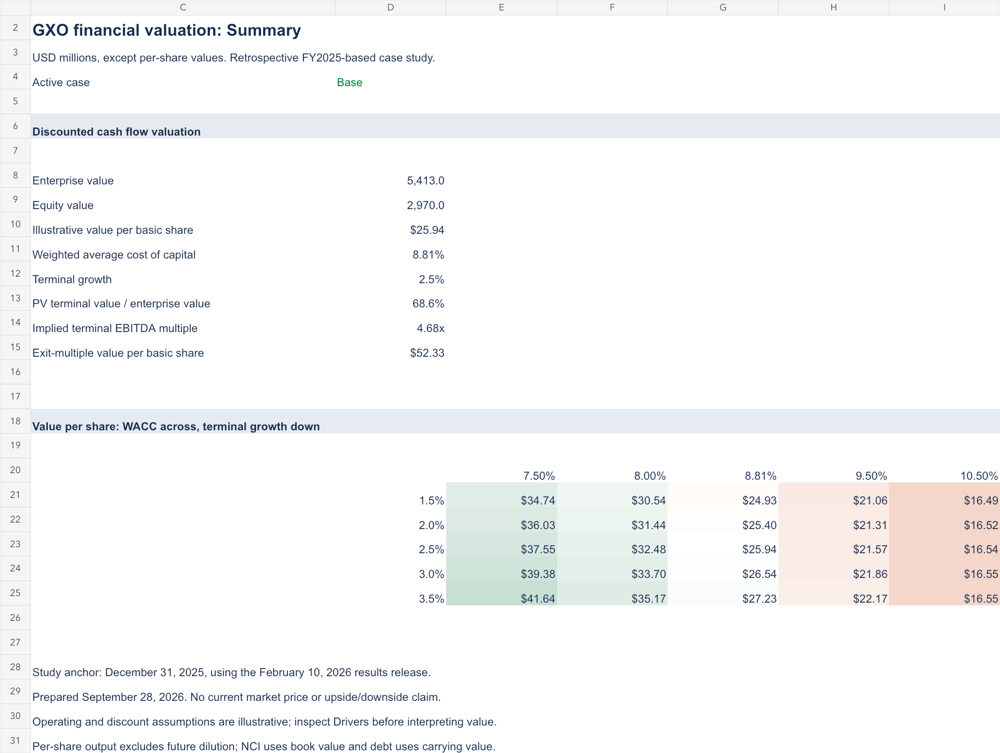

# GXO Logistics: Financial Modeling and Valuation

A five-year discounted cash flow case study connecting operating assumptions, reinvestment needs, cost of capital, and equity value. Includes an editable Excel model and an independently calculated Python version.

**[Download the Excel model](GXO_Valuation.xlsx)** · **[Read the valuation memo](research/valuation-memo.md)** · **[Review assumptions and sources](research/methodology.md)**



## Research question

How sensitive is the value of a contract-logistics business to margin improvement, cash reinvestment, and the assumptions used to value cash flows after the explicit forecast?

## Scope and date

Prepared September 28, 2026. This is a **retrospective FY2025-based educational case study**, using financial information published February 10, 2026. The calculation anchors at December 31, 2025, with illustrative 2026–2030 forecasts. It is not a real-time backtest, current price target, or investment recommendation. Later 2026 results are outside this deliberately fixed scope.

Historical financial inputs are reported data. Forecasts, discount-rate inputs, terminal ROIC, required cash, and the exit multiple are explicitly assumed. There is no live market-price comparison.

## Results under the stated assumptions

| Output | Downside | Base | Upside |
|---|---:|---:|---:|
| Enterprise value ($m) | 3,195.0 | 5,413.0 | 6,155.1 |
| Equity value ($m) | 752.0 | 2,970.0 | 3,712.1 |
| Value per year-end basic share | $6.57 | $25.94 | $32.42 |

These are operating scenarios, not confidence intervals. The base case uses **8.8125% WACC**, **2.5% terminal growth**, and **10% terminal ROIC**. Terminal value represents **68.6%** of base-case enterprise value.

An alternative, assumed **8.5x terminal EBITDA multiple** produces **$52.33 per basic share**, versus **$25.94** using reinvestment-linked perpetual growth. That difference is the main analytical finding: the exit assumption materially changes the answer and needs independent support. The 8.5x multiple is not a peer-derived market valuation.

## What the model demonstrates

- Five-year revenue, margin, tax, capex, and working-capital forecasts.
- Conversion of operating earnings into unlevered free cash flow.
- CAPM cost of equity and target-weighted WACC.
- Terminal reinvestment tied to growth and return on invested capital.
- Enterprise-to-equity bridge, including excess cash, debt, and minority interests.
- Base/downside/upside selection and 25 WACC/growth sensitivities.
- Alternative exit-multiple terminal valuation and explicit limitations.

## Use the workbook

1. Open `GXO_Valuation.xlsx` and start on **Summary**.
2. Change **Drivers!D5** to `1` (Base), `2` (Downside), or `3` (Upside).
3. Blue cells are editable assumptions or reported source inputs. Green formulas link between sheets.
4. Follow **DCF** to trace each calculation. **History** contains reported inputs and their source.
5. Keep WACC above terminal growth and terminal growth below terminal ROIC.

The workbook is formula-driven. The README, memo, JSON results, and PNG previews are the original publication snapshot and do not update when you edit Excel.

## Reproduce and test

Python 3, standard library only:

```bash
python3 model/valuation.py
python3 -m unittest discover -s model -v
```

Edit `model/inputs.json` before rerunning Python. Excel and JSON are separate editable interfaces; changes do not synchronize automatically. `model/build_workbook.mjs` regenerates Excel and previews where the OpenAI Artifact Tool runtime is available; it is not needed to use Excel or reproduce the Python calculations.

Validation includes six unit tests, independent Python/Excel calculation reconciliation across all three cases, WACC sensitivity, and a check that the sensitivity center matches the base valuation. [Validation details](research/validation.md).

## Source

[GXO FY2025 results release](https://investors.gxo.com/news-releases/news-release-details/gxo-reports-fourth-quarter-and-full-year-2025-results), consolidated financial statements and reconciliations. Period-end shares are converted from thousands to millions. See the [methodology](research/methodology.md) for field definitions and adjustments.

## Limitations

This is a focused operating DCF, not an integrated three-statement model or completed buy-side diligence. It does not include a comparable-company study, purchase accounting, pension adjustments, detailed lease schedules, future share dilution, or a current trading recommendation. Cash, debt, minority interests, and tax treatment require refinement before professional transaction use.
