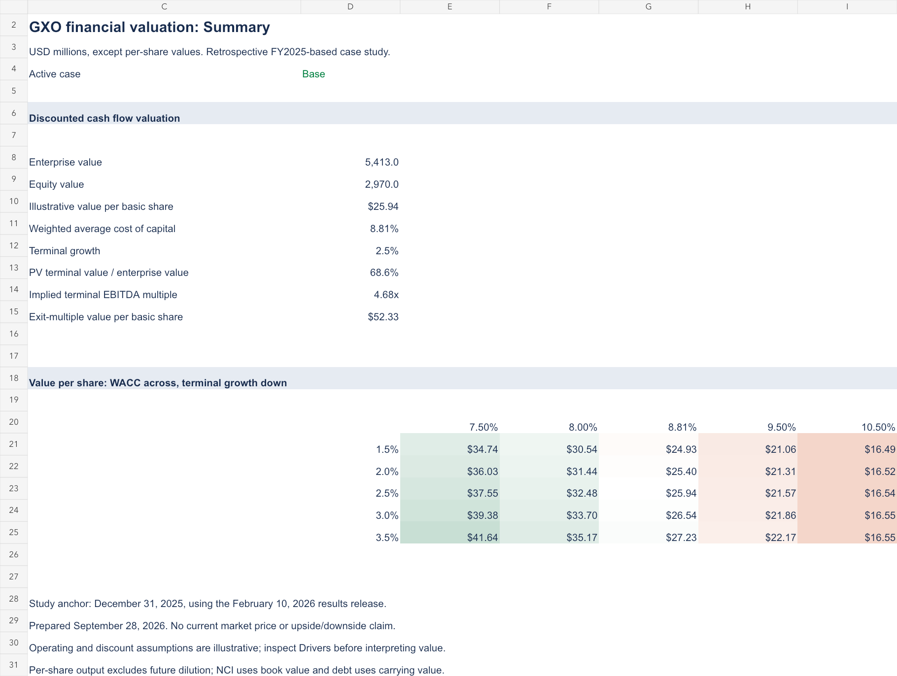

# GXO Logistics: Cash-Flow Valuation and Terminal Sensitivity

**Research question.** How much of GXO's estimated equity value depends on near-term operating performance, and how much depends on assumptions about cash generation after the five-year forecast?

[Excel model](GXO_Valuation.xlsx) · [Valuation memo](research/valuation-memo.md) · [Methods and inputs](research/methodology.md) · [Validation notes](research/validation.md)

## Findings

The base discounted cash flow values GXO at **$25.94 per year-end basic share** under the assumptions below. Discounted terminal value accounts for **68.6% of base enterprise value**. Applying an assumed **8.5× Year-5 adjusted EBITDA** exit multiple instead gives **$52.33 per basic share**. The alternative is a sensitivity check, not independent support for the higher value: the multiple was not estimated from peers. Reconciling the implied long-run growth, return on capital, and cash conversion matters more than averaging the two outputs.

| Output | Downside | Base | Upside |
|---|---:|---:|---:|
| Enterprise value ($m) | 3,195.0 | 5,413.0 | 6,155.1 |
| Equity value ($m) | 752.0 | 2,970.0 | 3,712.1 |
| Value per year-end basic share | $6.57 | $25.94 | $32.42 |

The operating scenarios share a common discount rate and have no assigned probabilities. They are conditional estimates, not confidence intervals.

## Study design

This is a retrospective FY2025 educational case study prepared September 28, 2026. It uses [GXO's February 10, 2026 earnings release](https://investors.gxo.com/news-releases/news-release-details/gxo-reports-fourth-quarter-and-full-year-2025-results) and anchors valuation at December 31, 2025, with illustrative forecasts for 2026–2030. Reported financial inputs and assumed drivers are recorded separately. Later disclosures and live market prices are outside the scope.

1. **Cash conversion.** Forecast revenue, margins, tax, capex, and operating working capital. Free cash flow to the firm is after-tax operating profit plus depreciation and amortization, less capex and the increase in operating working capital. Future asset-sale proceeds are excluded from recurring cash flow; the historical bridge separately reconciles company-defined free cash flow.
2. **Discount rate.** Use CAPM for the cost of equity and combine it with after-tax debt cost using assumed target capital weights. The base WACC is **8.8125%**. Beta, risk premium, debt cost, and capital weights are assumptions, not estimates fitted here.
3. **Terminal economics.** Use **2.5% long-run growth** and **10% terminal return on invested capital**. Reinvesting growth divided by return on capital implies 25% of terminal after-tax operating profit is reinvested. The model discounts the explicit cash flows and the perpetuity value, then adds excess cash and subtracts debt and minority interests to bridge to equity. The workbook also includes 25 WACC/growth sensitivities.

## Reproduce and review

Open the workbook on **Summary**. Use `Drivers!D5` to select `1` (Base), `2` (Downside), or `3` (Upside). Blue cells contain editable assumptions or historical inputs; green formulas link across sheets. **History** identifies source inputs and **DCF** shows the calculation. Keep WACC above terminal growth, and terminal growth below terminal return on capital.

The separate Python implementation uses only the standard library. Change [model/inputs.json](model/inputs.json) to test assumptions; Excel and JSON inputs are not synchronized.

```bash
python3 model/valuation.py
python3 -m unittest discover -s model -v
```

The [Python model](model/valuation.py) and [six unit tests](model/test_valuation.py) support checks of cash-flow reconciliation, equity-bridge arithmetic, sensitivity direction, and the terminal assumptions. Python and workbook calculations were reconciled across all three cases; the workbook was recalculated with Artifact Tool, not separately tested in native Excel. The included memo and workbook preview reflect the original inputs. [Workbook builder](model/build_workbook.mjs) is optional and requires `@oai/artifact-tool` to regenerate Excel and previews.



## Limitations

This is an operating DCF, not an integrated three-statement model or a current price target. There is no peer analysis, detailed lease or pension schedule, or forecast of future share dilution. Required cash, tax treatment, and the enterprise-to-equity bridge are simplified. Reconciliation verifies the mechanics, not the future assumptions. This is research and portfolio work, not an investment recommendation.
